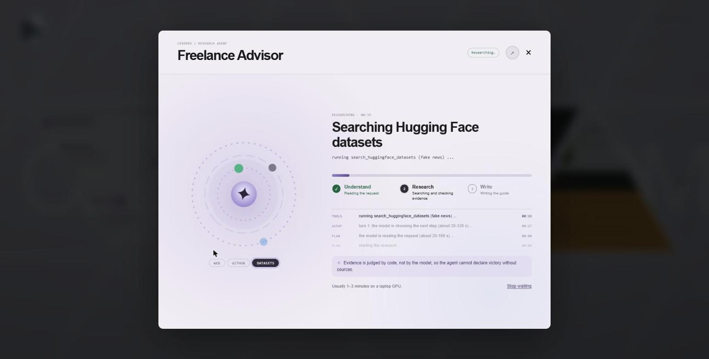
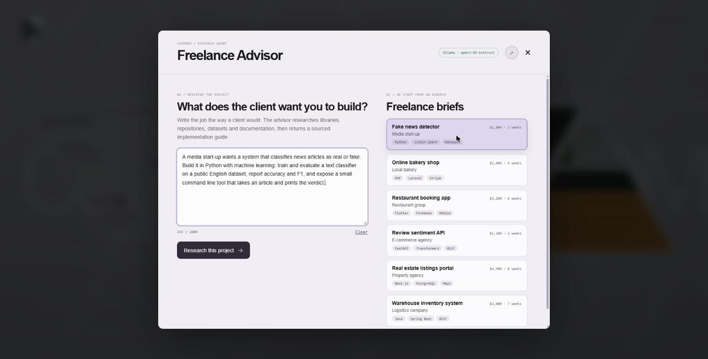
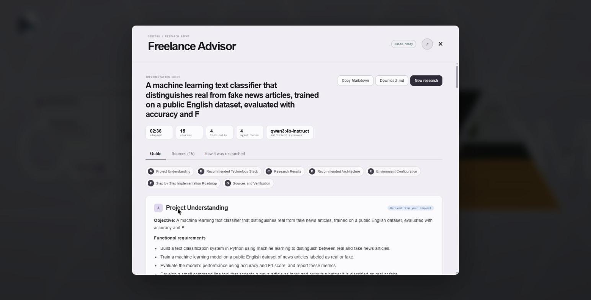
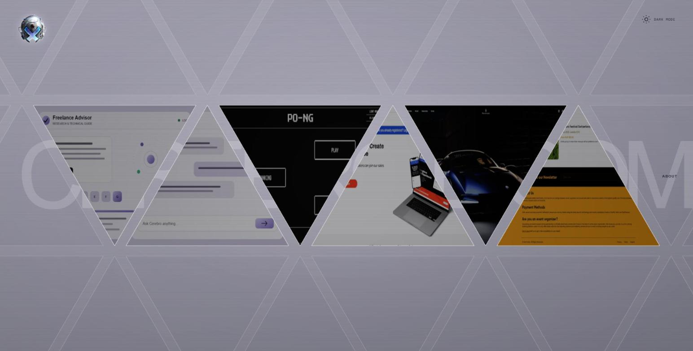
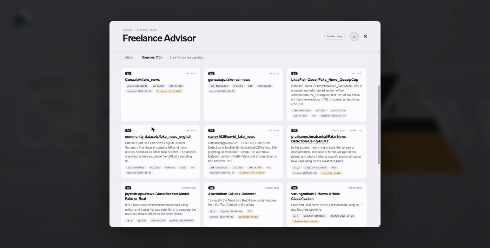
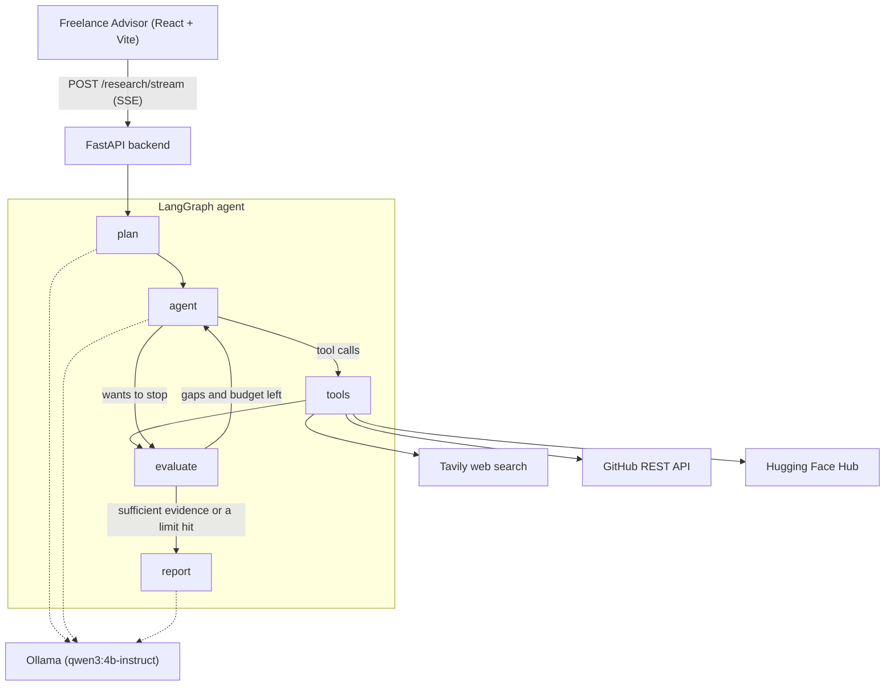

# Cerebro Freelance Advisor

**A local AI research agent that tells a freelancer how to build a project, with sources.**
Describe a client's project in plain language. The agent plans the research, picks its own tools (web search, GitHub, Hugging Face datasets), checks what it found, searches again where evidence is missing, and returns a sourced implementation guide: stack, architecture, environment setup and a step-by-step roadmap.


-000000)


It only **researches and advises**. It never clones, downloads, installs or runs anything, and the language model runs **on your own machine** through [Ollama](https://ollama.com): no hosted or paid LLM, no database, no accounts.

<p align="center">
  
</p>

## What it does

1. **Understands the request** and decides which tools are worth using for this particular project.
2. **Researches with real tools**: Tavily web search, GitHub repository search and README / dependency-file inspection, Hugging Face dataset search. Nothing is simulated.
3. **Judges its own evidence with code, not opinion.** A deterministic evaluator scores coverage of eight areas from the retrieved sources and sends the agent back when something is missing.
4. **Writes a seven-section guide (A to G)** in which every link comes from a tool result. Links or citations the model invents are removed and reported.
5. **Shows its work live** in a React front end: an animated loading screen driven by the agent's real progress events, then the guide, the sources and a record of how the research went.

It is not limited to Python or machine learning: it has been run on Flutter, Laravel, Next.js, Spring Boot and FastAPI briefs.

## Screenshots

| Start from a freelance brief | Result: the guide |
|---|---|
|  |  |
| **The gallery entry** | **Sources, each with its metadata** |
|  |  |

## How it works



| Node | What it does |
|---|---|
| **plan** | The model reads the request once (structured output): objective, requirements, assumptions, whether datasets or GitHub examples are needed. The plan is then checked against the request. |
| **agent** | The model decides: call a tool (which one, with which query) or stop. Its prompt is rebuilt from the evidence ledger every turn, so it always fits a 4096-token window. |
| **tools** | Executes the calls with timeouts, a per-turn cap, duplicate detection and unavailable-tool handling. Every result becomes numbered evidence (S1, S2, ...). |
| **evaluate** | Judges coverage from the evidence, not from the model's opinion, and tells the agent what is still open. |
| **report** | Writes sections A to G. A, C and G are built by code from the request and the evidence; B, D, E and F are model-written advice that is checked afterwards. |

### The guide

| Section | Content | Where it comes from |
|---|---|---|
| A. Project Understanding | objective, requirements, constraints, assumptions | derived from your request |
| B. Recommended Technology Stack | languages, frameworks, libraries, tools | model recommendation |
| C. Research Results | datasets, repositories, documentation, with metadata and risks | tool evidence |
| D. Recommended Architecture | components and folder structure | model recommendation |
| E. Environment Configuration | prerequisites, install commands, configuration | model recommendation |
| F. Step-by-Step Implementation Roadmap | phases with outputs and how to verify each | model recommendation |
| G. Sources and Verification | every source, what was verified, what was not | tool evidence |

### Safeguards

- **Grounded links.** Every URL and `[S#]` citation must exist in the evidence ledger, otherwise it is removed and listed under "Checks and limitations".
- **No guessed metadata.** Stars, downloads, licenses and dates are copied from API responses; missing values read "not stated".
- **Claims are cross-checked.** A model-written statement that cites a source but gives a different license, count or name is marked `[CHECK: ...]`.
- **Retrieved text is untrusted.** Instruction-like sentences and raw URLs found on websites or in READMEs are stripped before the model sees them, and no tool has side effects.
- **Graceful degradation.** If a tool fails or is not configured, the run continues and the guide states what could not be verified.

## Quick start

**You need:** [uv](https://docs.astral.sh/uv/) (it installs Python 3.12 for you), Node.js 18 or newer (tested on 20), and [Ollama](https://ollama.com) running locally.

```bash
git clone https://github.com/houssem-hbaieb/cerebro-freelance-advisor.git
cd cerebro-freelance-advisor
```

**1. Backend** (`agentic-freelance-advisor/`)

```bash
cd agentic-freelance-advisor
uv sync                                   # create .venv and install the locked dependencies
ollama pull qwen3:4b-instruct             # the recommended local model (about 2.5 GB)
cp .env.example .env                      # Windows PowerShell: copy .env.example .env
# edit .env and add your API keys (table below)
uv run python -m scripts.check_setup      # checks dependencies, config, keys and Ollama
uv run uvicorn app.main:app --reload      # API on http://127.0.0.1:8000  (docs at /docs)
```

**2. Front end** (`freelance2/`), in a second terminal

```bash
cd freelance2
npm install                               # Windows PowerShell: npm.cmd install
npm run dev                               # Windows PowerShell: npm.cmd run dev
```

Open **http://localhost:8766** and click the **Freelance Advisor** triangle. Pick one of the six example briefs or paste your own, then press **Research this project**. A run takes about 1 to 3 minutes with `qwen3:4b-instruct` on a laptop GPU.

If the badge in the dialog says **Advisor · Offline**, the API terminal is not running. The dev server forwards `/advisor` to `http://127.0.0.1:8000`, so no CORS setup is needed.

### API keys

Put them in `agentic-freelance-advisor/.env`. The file is git-ignored; only `.env.example` is committed.

| Variable | Needed? | Get it |
|---|---|---|
| `TAVILY_API_KEY` | For web search. Without it the agent still works with GitHub and Hugging Face and says the documentation could not be verified. | free at [app.tavily.com](https://app.tavily.com) (1,000 credits a month, no card) |
| `GITHUB_TOKEN` | Recommended: 30 instead of 10 searches a minute. | [fine-grained token](https://github.com/settings/personal-access-tokens), public repositories only, no extra permissions |
| `HF_TOKEN` | Optional. Public dataset metadata works anonymously. | [huggingface.co/settings/tokens](https://huggingface.co/settings/tokens) |

## Use the API directly

`POST /research` returns the whole result at once; `POST /research/stream` returns the same result as Server-Sent Events with live `progress` events first.

```bash
curl -X POST http://127.0.0.1:8000/research -H "Content-Type: application/json" --max-time 2400 \
     -d '{"project_description": "Build a REST API with FastAPI that classifies the sentiment of product reviews."}'
```

| Endpoint | Purpose |
|---|---|
| `GET /health` | API status, Ollama reachability, whether the model is installed, whether a run is in progress |
| `GET /tools` | The four research tools and whether each is configured |
| `POST /research` | Runs the agent and returns the report, sources, tool history, plan, evaluation and stats |
| `POST /research/stream` | The same run as Server-Sent Events: `progress`, then one `result` or `error` |

One run at a time (a second request gets HTTP 429) because one local GPU cannot serve two. PowerShell versions of the command, the response format and every setting are in [the backend README](agentic-freelance-advisor/README.md).

## Tests

```bash
cd agentic-freelance-advisor
uv run pytest                             # 258 tests, no network and no model needed
```

The APIs are mocked and the language model is replaced by a scripted fake, so the suite runs in seconds. The front end is checked with `npm run build`. Live checks against the real services are in `scripts/` (`smoke_ollama`, `try_tools`, `run_agent`).

## Performance

Measured on one laptop (RTX 2050 with 4 GB of VRAM, i7-12700H, 24 GB RAM), same request:

| | `qwen3:4b` (thinking-only build) | **`qwen3:4b-instruct` (recommended)** |
|---|---|---|
| Full run | 13 to 22 minutes | **about 1.5 to 3 minutes** |
| Calls cut off with no answer | 3 to 5 per run | 0 |
| `.env` | `OLLAMA_MODEL=qwen3:4b`, `OLLAMA_REASONING=true` | `OLLAMA_MODEL=qwen3:4b-instruct`, `OLLAMA_REASONING=false` |

## Project layout

```
.
├── agentic-freelance-advisor/     Python backend
│   ├── app/
│   │   ├── main.py                FastAPI app: /health, /tools, /research, /research/stream
│   │   ├── config.py              settings from environment / .env
│   │   ├── agent/                 LangGraph agent: graph, nodes, prompts, evaluation, report, LLM
│   │   ├── tools/                 web search, GitHub search and inspection, dataset search
│   │   └── schemas/               all data models
│   ├── scripts/                   setup check, Ollama smoke test, tool tryout, live agent run
│   ├── tests/                     258 unit tests
│   ├── README.md                  backend guide: API, configuration, performance, limitations
│   └── REPORT.md                  full project report: design, measurements, bugs found and fixed
└── freelance2/                    React + Vite front end (the Cerebro gallery)
    └── src/
        ├── AdvisorDialog.jsx      the Freelance Advisor screen and its loading animation
        ├── advisor-run.js         run store: POST /research/stream and parse the event stream
        ├── markdown.jsx           renders the guide without raw HTML
        └── advisor-examples.js    the freelance example briefs
```

## Limitations

- **It is a small local model.** Tool choices are usually sensible, but sections B, D, E and F are plausible recommendations that can be generic. They are labelled as model-written and never presented as verified.
- **Coverage scoring is a keyword proxy** over retrieved titles, snippets and README excerpts. It names the sources that matched but does not judge their quality.
- **One run at a time**, and pressing "Stop waiting" does not stop the model: the server finishes its current step first.
- **Without a GitHub token** search is limited to 10 requests a minute.
- Out of scope by design: RAG and vector stores, a database, authentication, Docker and fine-tuning.

## Credits and assets

The Cerebro gallery in `freelance2/` is a React portfolio built with Vite. Its sample project images in `freelance2/cerebro/_next/static/media/` (Bee Tickets, Maserati, Autotorino, PO-NG) are archived media of the original site the gallery was modelled on (the front end's own README calls this folder "the local archive of original site media"). They were not created for this repository and are not covered by its work. They are kept only so the demo gallery has content: replace them with your own before reusing the front end.

No license has been chosen for this repository yet.
